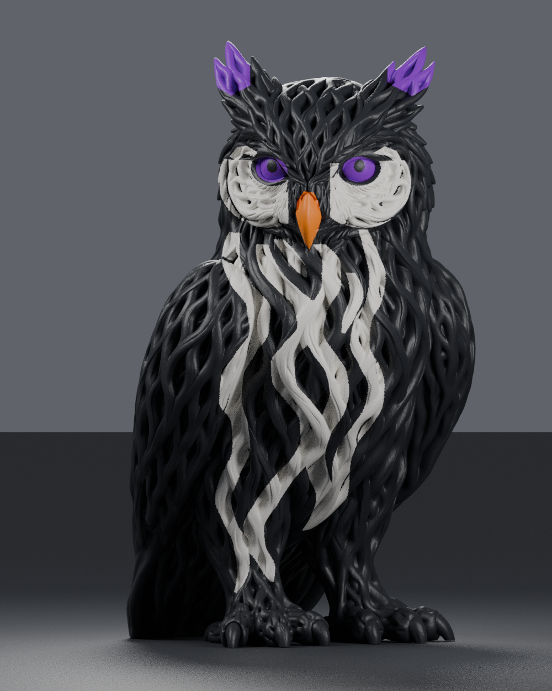

# Rootwoven owl — four-color Snapmaker U1 project

- [Download the colored 3MF for Snapmaker Orca](https://github.com/redfirstgen1/3d-printing/raw/refs/heads/main/rootwoven-owl/Rootwoven-Owl-U1-4-Color.3mf)
- [Download the complete ZIP](https://github.com/redfirstgen1/3d-printing/raw/refs/heads/main/rootwoven-owl/Rootwoven-Owl-U1-Color-Package.zip)
- [Opening instructions](rootwoven-owl/OPEN-IN-ORCA.txt)

Open the 3MF **as a project** in Snapmaker Orca. The colors are already painted: **1 black, 2 white/ivory, 3 purple, 4 orange**. Use the download links above, or **Download raw file** on the GitHub file page. If private, stay signed into GitHub. Extract the ZIP before opening its 3MF.

Prepared for the Snapmaker U1 with four 0.4 mm nozzles, Generic PLA, 0.16 mm layers, tree supports, and a 5 mm outer brim. The original model size is approximately 56.90 × 57.20 × 97.67 mm. Confirm the profiles for your actual filament and inspect supports and sliced layers before printing.

The uploaded sculpt was surface-painted using the supplied reference colors. Geometry checks passed with no boundary edges, non-manifold edges, or degenerate triangles. All four paint assignments survived a Snapmaker Orca import/export, and a slicing check generated extrusion for all four tools. The starting profile estimates about 8 h 45 min and 104 g PLA including supports and the prime tower; actual results can vary. This has **not been physically test printed**.

---

# Butterfly and roses display

A two-color, procedural interpretation of a butterfly and rose display, prepared for importing into Snapmaker Orca with a Snapmaker U1 and 0.4 mm nozzles.

## Download

- [Download the multipart 3MF](https://github.com/redfirstgen1/3d-printing/raw/refs/heads/main/butterfly-display/butterfly-display.3mf) — open this in Orca.
- [Download the complete ZIP](https://github.com/redfirstgen1/3d-printing/raw/refs/heads/main/butterfly-display-package.zip) — includes STL files and editable source. Extract before opening.
- [Slicing instructions](butterfly-display/PRINT-INSTRUCTIONS.md)

If a download link opens a file page, use **Download raw file**. Remain signed into GitHub if this repository is private.

Dimensions: approximately **72 × 63.5 × 71.2 mm**. Black and white are separate aligned material parts. Keep them together as one multipart object and assign your black and white PLA tools in Orca.

Both color meshes have zero non-manifold edges; the black structure is connected. The white material contains separate decorative regions. This is a geometry package, not sliced G-code or a verified Orca printer project. It has **not been sliced in Orca or physically test printed**. Inspect supports and every layer before printing.
