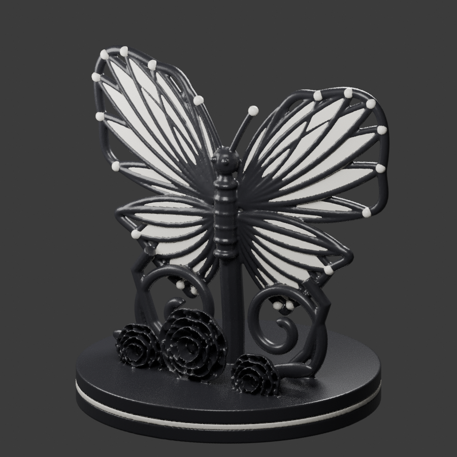

# Butterfly and roses display

A two-color, procedural interpretation of a butterfly and rose display, prepared for importing into Snapmaker Orca with a Snapmaker U1 and 0.4 mm nozzles.

## Download

- [Download the multipart 3MF](https://github.com/redfirstgen1/3d-printing/raw/refs/heads/main/butterfly-display/butterfly-display.3mf) — open this in Orca.
- [Download the complete ZIP](https://github.com/redfirstgen1/3d-printing/raw/refs/heads/main/butterfly-display-package.zip) — includes STL files and editable source. Extract before opening.
- [Slicing instructions](butterfly-display/PRINT-INSTRUCTIONS.md)

If a download link opens a file page, use **Download raw file**. Remain signed into GitHub if this repository is private.

Dimensions: approximately **72 × 63.5 × 71.2 mm**. Black and white are separate aligned material parts. Keep them together as one multipart object and assign your black and white PLA tools in Orca.

Both color meshes have zero non-manifold edges; the black structure is connected. The white material contains separate decorative regions. This is a geometry package, not sliced G-code or a verified Orca printer project. It has **not been sliced in Orca or physically test printed**. Inspect supports and every layer before printing.
